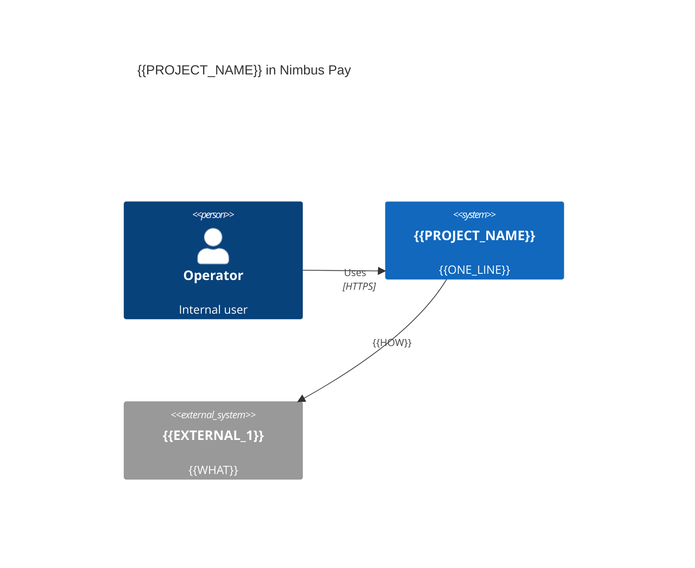
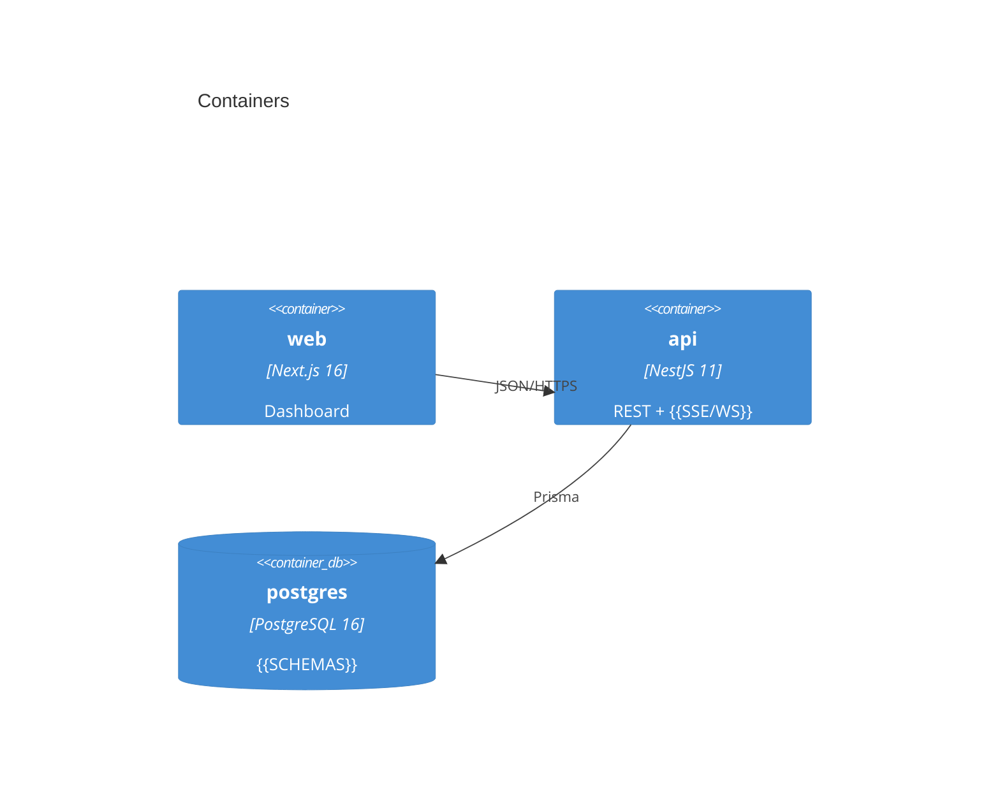
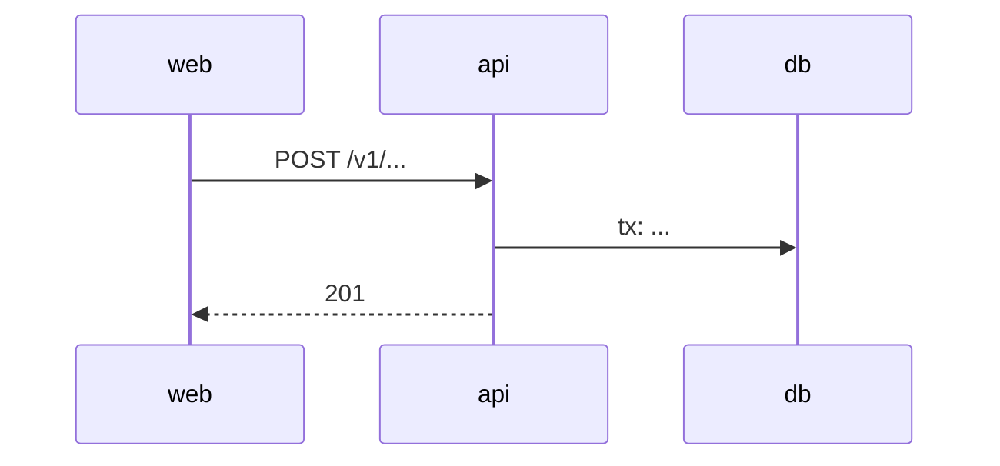
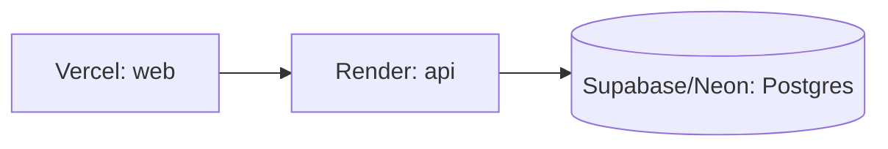

# Architecture — {{PROJECT_NAME}}

## 1. Context (C4 level 1)

## 2. Containers (C4 level 2)

## 3. Key flows

### 3.1 {{FLOW_NAME}}

## 4. Where things live

| Concept | Path |
|---------|------|
| Domain rules | `apps/api/src/<module>/domain/` |
| HTTP layer | `apps/api/src/<module>/http/` |
| Persistence | `apps/api/prisma/`, `apps/api/src/<module>/infra/` |
| Contracts | `packages/shared/src/` |
| UI components | `apps/web/src/components/ui/` |

## 5. Cross-cutting
- Validation, errors, pagination, idempotency: per Spec 00 section 5.
- Logging and tracing: {{DETAILS}}
- Security: {{AUTH + SIGNATURES}}
- Configuration: `packages/shared/src/env.ts`

## 6. Deployment

## 7. Known limitations
- {{LIMITATION}}
